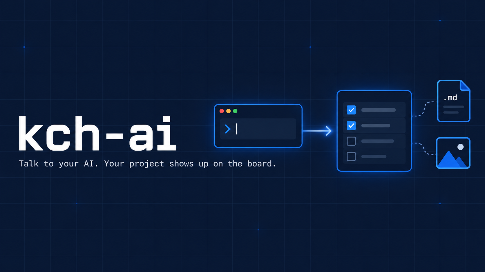

English | [한국어](README.ko.md)

<p align="center">
  
</p>

# kch-ai

**Register and update your AI projects on KCH AI Status — just by talking to your AI.**

*Don't fill out forms. Just tell your AI.*

[Quick Start](#quick-start) • [What It Does](#what-it-does) • [The Project Document](#the-project-document) • [For AI Agents](#for-ai-agents) • [KCH AI Status](https://ai.kchglobal.co.kr) • [Contact](mailto:lee90@kchglobal.co.kr)

---

## Quick Start

**Step 1: Install**

Tell your AI (Codex or Claude Code — app or terminal):

```
https://github.com/lee90-creator/kch-ai-skill install this skill
```

One install covers every AI tool on your PC (Codex, Claude Code, Aside).

**Step 2: Allow once**

The first time you use it, a browser page opens. Check that the code matches the one your AI shows, then click **허용 (Allow)**. It won't ask again on that PC.

**Step 3: Talk**

Open your project folder and say:

```
Use the kch-ai skill to read this project's .md files, write it up, and post it to KCH AI Status.
```

That's it. Your AI writes a project document, shows you exactly what will change, and posts it after you say yes.

> **Note:** Web / mobile Claude chat will most likely not work. Use Codex or Claude Code (app or terminal).

---

## Why kch-ai?

- **Zero forms** — describe your project in plain words; your AI reads the repo and fills in every field
- **One document, always** — every change goes through `kch-ai-project.md`, and the document is attached to your project each time
- **Always asks first** — nothing is posted until you see the full list of changes and say yes
- **Asks, never guesses** — your role, your teammates, and which files to attach are always confirmed with you
- **Your projects only** — the skill can touch only projects you take part in
- **Safe uploads** — files with keys, tokens, or passwords are refused; files outside your repository (including links pointing outside) are refused
- **Install once, use everywhere** — one copy on your PC, shared by Codex, Claude Code, and Aside
- **No expiry, easy to revoke** — stays connected until you disconnect it; stops after a year unused

---

## What It Does

| You say | What happens |
| --- | --- |
| "Write up this project and post it" | Reads the repo → writes `kch-ai-project.md` → asks your role, teammates, attachments → posts summary, status, roles, teammates, files, and the document itself |
| "Update it on KCH AI Status" | Compares the document with what's posted and changes only what differs |
| "We moved to QA" | Edits the status line in the document → posts it |
| "Add 김혜민 as QA" | Adds a teammate line → finds them in the company directory → posts it |
| "Attach this screenshot" | Adds the file to the document's attachment list → uploads it with the document |
| "Undo that" | Reverts this PC's last change (within 24 hours, and only if nobody edited it since) |

Not done by the skill (use the website): removing teammates, deleting attachments, renaming a project.

**Status values:** 계획 중 (planning) / 개발 중 (in development) / QA 중 (trial in real work) / 개발 완료 (in use)
**Roles:** 기획 (planning) / 개발 (development) / QA / 현업 담당 (business owner) / 운영 (operations)

---

## The Project Document

`kch-ai-project.md` lives at the top of your repository. Your AI writes it; you review it. Commit it, and next time just edit and post again.

```markdown
# 세금계산서 자동수집 로봇

- 진행 상태: QA 중
- 내 역할: 기획, 개발

## 어떤 일을 편하게 하나요 (한 문장, 필수)
직원이 매달 27개 법인 세금계산서를 일일이 받던 일을 자동으로 끝냅니다.

## 예전에는 어떻게 했나요
## 지금 되는 부분이나 제한
## 앞으로 할 일

## 함께 하는 사람
- 김혜민 (경영지원본부): QA, 현업 담당

## 첨부
- docs/screens/main.png

## 참고
- 구성 / 기능 흐름 / 사용 방법 / 저장·복구 / 확인한 것 / 주의점
```

| Section | Posted as |
| --- | --- |
| Title, `진행 상태`, `내 역할` | Project name, status, your roles |
| `어떤 일을 편하게 하나요` (required) | The one-line summary everyone sees |
| `예전에는…` / `지금 되는…` / `앞으로 할 일` | The optional detail fields |
| `함께 하는 사람` | Teammates and their roles (`- Name (Division): role, role`) |
| `첨부` | Files inside the repo to upload (PDF, PNG, JPG, GIF, MD, TXT, LOG, ≤ 20 MB) |
| `참고` | Not a field — the full write-up, shared as the attached document |

---

## For AI Agents

Full instructions are in [`SKILL.md`](SKILL.md). The tool is `scripts/kch-ai.mjs` (Node.js 18+, no dependencies).

| Command | Purpose |
| --- | --- |
| `sheet` | Print the current project as a document (or an empty template) |
| `apply` | Show the change list and stop (exit code 2) — show it to the user |
| `apply --yes` | Post the document after the user agreed |
| `show` / `list` | Read-only: this folder's project / all my projects |
| `attach <file> --yes` | Upload a file from outside the repo (requires the document; uploads it too) |
| `undo` | Revert this PC's last change |
| `login` / `logout` / `whoami` | Connection |

Direct-change commands (`new`, `profile`) are refused on purpose: every change goes through the document.

---

## Updating

Tell your AI:

```
update the kch-ai skill
```

It downloads the latest version and runs `node scripts/install.mjs` again.

## Requirements

- Node.js 18 or later
- Codex or Claude Code (app or terminal)
- A KCH company Google account listed in the company directory

## Contact

Questions: **lee90@kchglobal.co.kr**

---

<p align="center"><b>Don't fill out forms. Just tell your AI.</b><br><sub>Internal tool for KCH Group.</sub></p>
